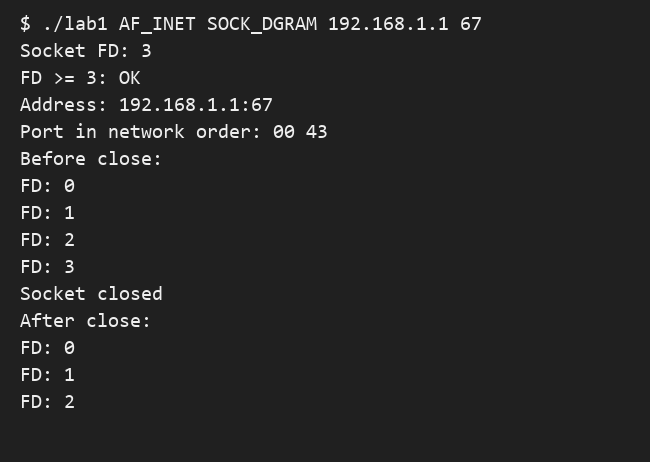
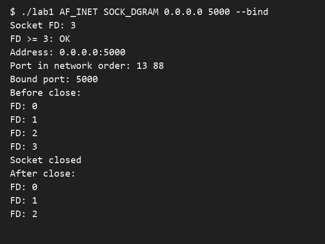
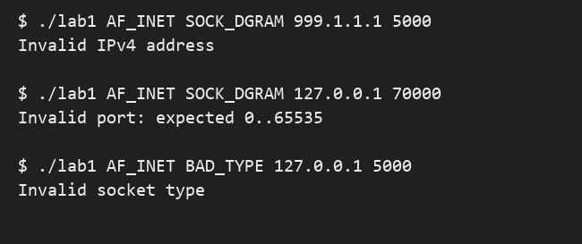
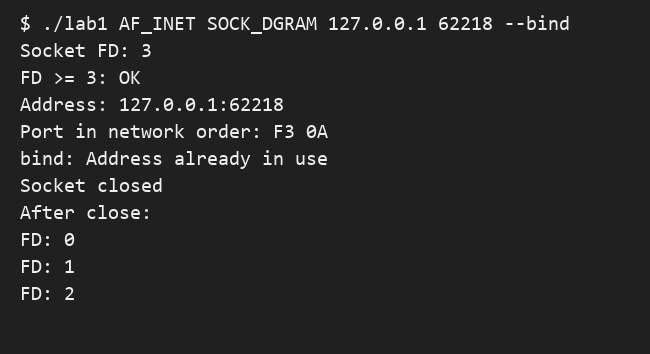

# Лабораторная работа № 1

**Тема:** Базовые системные вызовы сокетов и адресация в C/C++.

**Выполнил:** Кудаев М. С., группа ПИЖ-б-о-24-1.

**Институт:** информационных технологий и кибербезопасности.

**Кафедра:** программная инженерия.

**Проверила:** Белик А. И.

## 1. Цель работы

Научиться создавать сокеты, заполнять сетевые адреса, использовать `bind()` и обрабатывать ошибки системных вызовов.

## 2. Задание — вариант 6, продвинутый уровень

Написать утилиту `./lab1 <domain> <type> <ip> <port> [--bind]`.
Она должна создавать сокет, выводить его дескриптор и адрес, выполнять привязку при наличии `--bind` и закрывать сокет после работы.
Проверить неверный IP, порт больше 65535, занятый порт и неверный тип сокета.

**Дополнительное требование варианта 6:** проверить, что дескриптор сокета не меньше 3.

Для базового задания используются `AF_INET`, `SOCK_DGRAM`, адрес `192.168.1.1`, порт `67`. Для среднего — привязка UDP-сокета к `INADDR_ANY:5000` и вывод открытых FD до и после закрытия.

## 3. Краткая теория

Сокет — конечная точка сетевого обмена, к которой программа обращается через файловый дескриптор. `SOCK_STREAM` используется для TCP, `SOCK_DGRAM` — для UDP при семействе `AF_INET` и протоколе 0.
Порт хранится в сетевом порядке байт: для этого применяется `htons()`. Адрес преобразуется функцией `inet_pton()`, обратное преобразование выполняет `inet_ntop()`.

## 4. Сборка и запуск

Код: [lab1.c](lab1.c). Требуется Linux или совместимая POSIX-среда с `/proc/self/fd`.

```sh
gcc -std=c11 -Wall -Wextra lab1.c -o lab1
./lab1 AF_INET SOCK_DGRAM 192.168.1.1 67
./lab1 AF_INET SOCK_DGRAM 0.0.0.0 5000 --bind
```

Первый запуск только создаёт сокет и формирует адрес. Подключение к `192.168.1.1` не выполняется. Во втором запуске сокет привязывается к локальному порту 5000.

## 5. Результаты работы

Программа собрана и проверена в Cygwin под Windows, GCC 14.4.0. Ниже показан вывод фактических запусков.

### Создание сокета



Дескриптор равен 3. Порт 67 имеет сетевое представление `00 43`.

### Привязка к порту 5000



После `close()` дескриптор сокета исчезает из списка открытых FD.

### Неверные IP, порт и тип сокета



### Занятый порт

Для проверки другой процесс удерживал UDP-порт на `127.0.0.1`. Повторный `bind()` вернул ошибку занятого адреса, после чего программа закрыла свой сокет.



## 6. Ответы на контрольные вопросы

**1. Что такое файловый дескриптор? Какие стандартные дескрипторы существуют?**

Это неотрицательный номер открытого ресурса процесса. Стандартные FD: 0 — ввод, 1 — вывод, 2 — вывод ошибок.

**2. Почему первый сокет обычно получает дескриптор 3?**

Потому что 0, 1 и 2 обычно уже заняты. Если один из них закрыт, сокет может получить меньший номер.

**3. Что такое сокет? Из чего он состоит?**

Это конечная точка обмена данными. Для IP-сокета используются IP-адрес, порт и протокол; процесс обращается к нему по FD.

**4. Зачем нужны htons() и htonl()?**

Они переводят 16- и 32-битные числа в сетевой порядок байт. Без преобразования на Little-Endian машине порт может быть прочитан неверно.

**5. Чем отличаются inet_pton() и inet_addr()?**

`inet_pton()` поддерживает IPv4 и IPv6 и отдельно сообщает об успехе или ошибке. У `inet_addr()` ошибка неотличима от адреса `255.255.255.255`.

**6. Какие параметры принимает socket()? Что означает protocol = 0?**

Семейство адресов, тип сокета и протокол. Ноль означает выбор подходящего протокола системой.

**7. Для чего нужен bind()? Что такое INADDR_ANY?**

`bind()` назначает сокету локальный адрес и порт. `INADDR_ANY` означает все локальные IPv4-интерфейсы.

**8. Как обрабатывать ошибки? Что выводит perror()?**

Проверять возвращаемые значения вызовов. `perror()` печатает пояснение ошибки по `errno`.

**9. Что означает EADDRINUSE?**

Запрашиваемый адрес и порт уже заняты. Нужно сообщить об ошибке и освободить свой сокет либо выбрать другой порт.

**10. Почему сокет считается файлом?**

В UNIX сокеты входят в общую систему дескрипторов: `socket()` соответствует созданию ресурса, `recv()` и `send()` — чтению и записи, `close()` — закрытию.

**11. Что такое сетевой порядок байт?**

Это Big-Endian: старший байт идёт первым. Единый порядок нужен для обмена между разными архитектурами.

**12. Как преобразовать IP-адрес в бинарный вид и обратно?**

Через `inet_pton()` и `inet_ntop()` соответственно.

**13. Какие семейства адресов и типы сокетов существуют?**

Семейства: `AF_INET`, `AF_INET6`, `AF_UNIX`. Типы: `SOCK_STREAM`, `SOCK_DGRAM`, `SOCK_RAW`.

**14. Зачем обнулять sockaddr_in?**

Чтобы не оставлять неинициализированные поля. В программе используется инициализация `{0}` вместо `memset()`.

**15. Почему нужно закрывать сокет?**

Чтобы освободить дескриптор и ресурсы ядра и не накапливать утечки.

## 7. Вывод

Создал UDP-сокет, заполнил адрес, выполнил привязку к порту и проверил обработку ошибок. Научился использовать `socket()`, `bind()`, `htons()`, `inet_pton()` и `close()`. Проверка `FD >= 3` выполнена, после закрытия FD освобождается.

[Word-файл для сдачи](Отчет_ЛР1_Вариант_6.docx).
