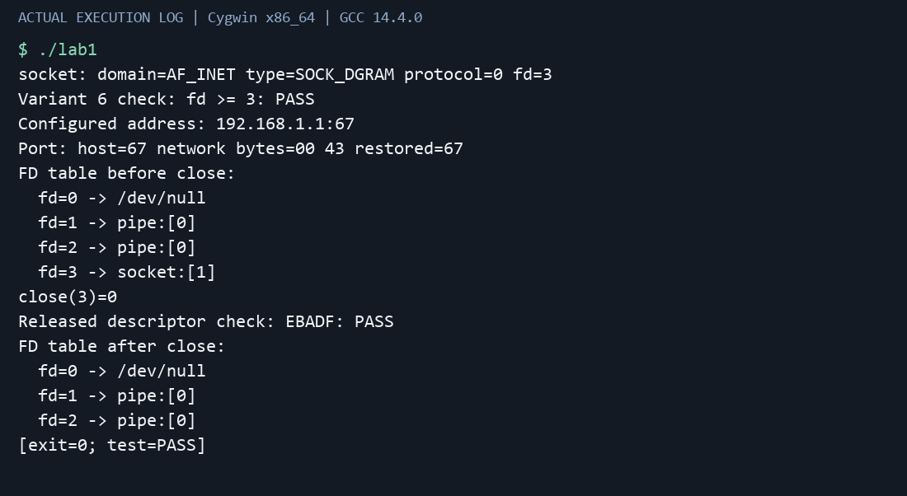
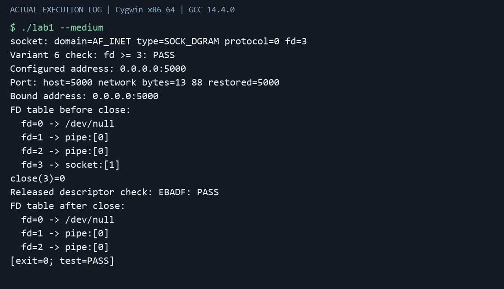
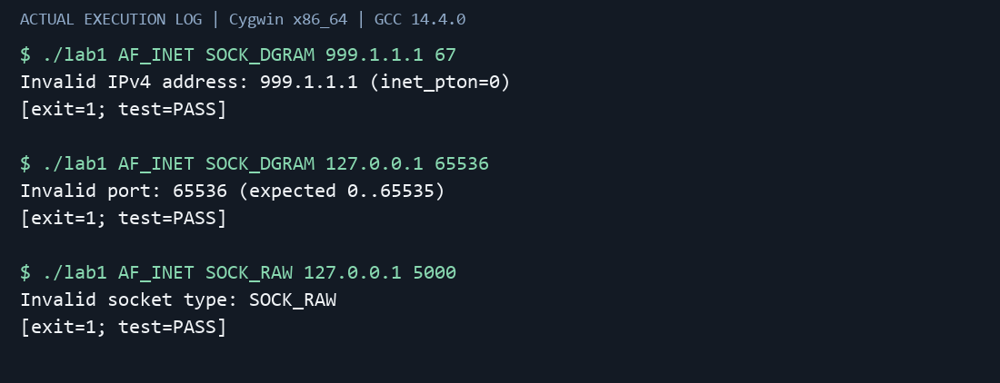
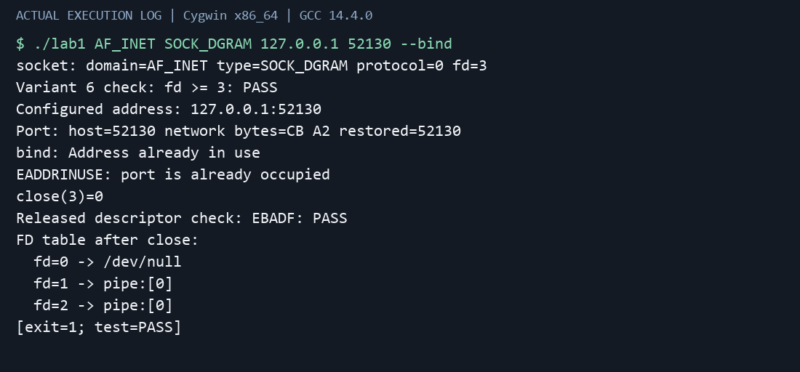
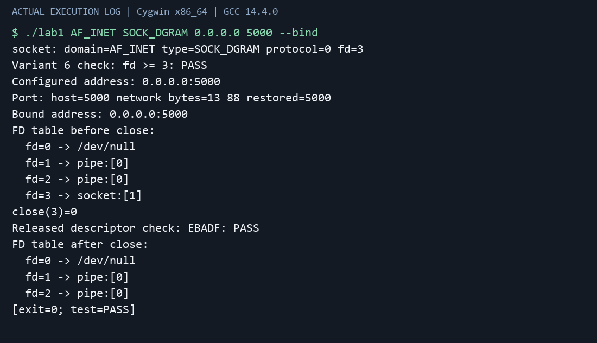
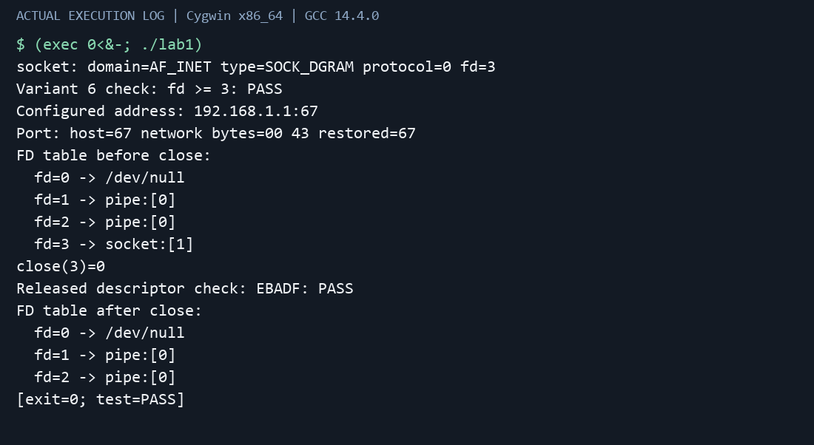

# Отчёт по лабораторной работе № 1

**Тема:** Базовые системные вызовы сокетов и адресация в C/C++.

**Вариант:** 6. **Выполнил:** Кудаев М. С., группа ПИЖ-б-о-24-1.

**Университет:** Северо-Кавказский федеральный университет.

**Институт:** Информационных технологий и кибербезопасности.

**Кафедра:** Программная инженерия.

**Проверила:** Белик А. И.

Этот README содержит полный отчёт: цель, задание, теорию, реализацию, результаты выполнения, ответы на контрольные вопросы и выводы. [Краткий Word-отчёт для сдачи](Отчет_ЛР1_Вариант_6.docx).

## Цель работы

Освоить создание IPv4-сокетов на языке C, заполнение sockaddr_in, преобразование IP-адресов и порядка байт, привязку UDP-сокета к локальному порту и обработку ошибок. Научиться контролировать время жизни файлового дескриптора и проверять его освобождение после close().

## Задание варианта 6

Базовый уровень, вариант 6. Создать сокет AF_INET / SOCK_DGRAM с protocol=0, заполнить sockaddr_in для адреса 192.168.1.1 и порта 67. Использовать inet_pton() и htons(), вывести дескриптор и адрес в текстовом виде, проверить результаты вызовов.

Средний уровень, вариант 6. Привязать UDP-сокет к INADDR_ANY и порту 5000 с помощью bind(). Обработать ошибки. Вывести таблицу открытых дескрипторов из /proc/self/fd до и после close(), подтвердить освобождение сокета.

Продвинутый уровень, вариант 6. Реализовать запуск ./lab1 <domain> <type> <ip> <port> [--bind], проверить неверный IP, порт больше 65535, занятый порт и неверный тип сокета. Дополнительное требование: проверить, что дескриптор сокета всегда не меньше 3.

## Теоретическая часть

Файловый дескриптор представляет собой неотрицательное целое число, индекс записи в таблице открытых ресурсов процесса. Обычно дескрипторы 0, 1 и 2 заняты стандартным вводом, стандартным выводом и выводом ошибок. Поэтому первый новый ресурс часто получает номер 3. Если стандартный дескриптор закрыт, ядро вправе использовать освободившийся меньший номер.

Сокет является конечной точкой обмена данными. Вызов socket(domain, type, protocol) создаёт сокет и возвращает дескриптор либо −1 при ошибке. AF_INET задаёт IPv4; SOCK_DGRAM с protocol=0 выбирает UDP, SOCK_STREAM с protocol=0 выбирает TCP. UDP сохраняет границы сообщений, но не гарантирует их доставку и порядок. TCP предоставляет упорядоченный поток байтов и контроль доставки в пределах действующего соединения.

Структура sockaddr_in содержит семейство sin_family, порт sin_port и IPv4-адрес sin_addr. Инициализация {0} обнуляет также служебные байты. inet_pton() переводит текст IPv4 в бинарное представление; inet_ntop() выполняет обратное преобразование. Адрес после inet_pton() уже хранится в сетевом порядке, поэтому повторное htonl() к нему не применяется.

Сетевой порядок байт соответствует Big-Endian. htons() переводит 16-битный порт из порядка хоста в сетевой, ntohs() выполняет обратное преобразование. Для 32-битных величин применяют htonl() и ntohl(). В варианте 6 порт 67 равен 0x0043 и хранится как байты 00 43; порт 5000 равен 0x1388 и хранится как 13 88.

bind() связывает сокет с локальным адресом и портом. INADDR_ANY означает все локальные IPv4-интерфейсы. Сокет UDP после bind() готов к работе с датаграммами; listen() для него не требуется. Ошибки проверяются по возвращаемым значениям и errno, текст выводится perror(). close() освобождает дескриптор процесса; забытое закрытие приводит к утечке ресурсов.

## Алгоритм решения

Сначала восстанавливаются закрытые стандартные дескрипторы через /dev/null, затем проверяются аргументы. Порт проверяется до сужения к unsigned short. Адрес обнуляется и заполняется; неверный IP отклоняется при inet_pton()=0. После socket() проверяются fd≥0 и fd≥3. При --bind выполняются bind() и getsockname(). Последний позволяет увидеть реальный порт, в том числе при переданном значении 0.

Директория /proc/self/fd читается через opendir()/readdir()/readlink(); её собственный временный дескриптор исключается из вывода. Все пути после создания сокета ведут к единой секции cleanup. После close() вызов fcntl(fd, F_GETFD) должен вернуть −1 с errno=EBADF. Таблица дескрипторов выводится повторно, уже без сокета.

## Сборка и запуск

Требуются GCC, make, Python 3 и доступ к `/proc/self/fd` в Linux или совместимой POSIX-среде.

```sh
git clone https://github.com/SETAVR/Setevoe_program.git
cd Setevoe_program/lab1
make
./lab1
./lab1 --medium
./lab1 AF_INET SOCK_DGRAM 0.0.0.0 5000 --bind
./lab1 AF_INET SOCK_DGRAM 127.0.0.1 0 --bind
./lab1 --help
make test
```

Сборка без make:

```sh
gcc -std=c11 -Wall -Wextra -Wpedantic -Werror -O2 lab1.c -o lab1
python3 tests.py ./lab1
```

Базовый запуск только создаёт сокет и формирует адрес `192.168.1.1:67`: пакеты не отправляются, `bind()` не вызывается. Наличие такого локального интерфейса и привилегии на порт 67 не требуются. С `--bind` необходимо указать локальный IP либо `0.0.0.0`. Утилита закрывает сокет после диагностики.

## Листинг программы

[Исходный файл lab1.c](lab1.c).

```c
#define _POSIX_C_SOURCE 200809L
#include <arpa/inet.h>
#include <dirent.h>
#include <errno.h>
#include <fcntl.h>
#include <limits.h>
#include <netinet/in.h>
#include <stdio.h>
#include <stdlib.h>
#include <string.h>
#include <sys/socket.h>
#include <unistd.h>

/* Reserve standard descriptors so socket() cannot return 0, 1 or 2. */
static int prepare_standard_fds(void) {
    for (int i = 0; i < 3; ++i) {
        if (fcntl(i, F_GETFD) >= 0) continue;
        if (errno != EBADF) { perror("fcntl standard fd"); return -1; }
        int fd = open("/dev/null", O_RDWR);
        if (fd < 0) { perror("open /dev/null"); return -1; }
        if (fd != i) {
            int copied = dup2(fd, i);
            int saved = errno;
            if (close(fd) < 0) { perror("close temporary fd"); return -1; }
            if (copied < 0) { errno = saved; perror("dup2"); return -1; }
        }
    }
    return 0;
}

/* Do not show the descriptor temporarily used to read /proc/self/fd. */
static int print_fds(const char *heading) {
    printf("%s\n", heading);
    DIR *dir = opendir("/proc/self/fd");
    if (!dir) { perror("opendir /proc/self/fd"); return -1; }
    int own_fd = dirfd(dir), result = 0;
    if (own_fd < 0) { perror("dirfd"); result = -1; }
    while (result == 0) {
        errno = 0;
        struct dirent *entry = readdir(dir);
        if (!entry) {
            if (errno) { perror("readdir"); result = -1; }
            break;
        }
        if (entry->d_name[0] == '.') continue;
        char *end;
        long fd = strtol(entry->d_name, &end, 10);
        if (*end || fd == own_fd) continue;
        char path[512], target[4096];
        int size = snprintf(path, sizeof(path), "/proc/self/fd/%s", entry->d_name);
        if (size < 0 || (size_t)size >= sizeof(path)) {
            fprintf(stderr, "FD path too long\n"); result = -1; break;
        }
        ssize_t n = readlink(path, target, sizeof(target) - 1);
        if (n < 0) { perror("readlink"); result = -1; break; }
        target[n] = '\0';
        printf("  fd=%ld -> %s\n", fd, target);
    }
    if (closedir(dir) < 0) { perror("closedir"); result = -1; }
    return result;
}

static int parse_port(const char *text, unsigned short *port) {
    if (!*text) return -1;
    for (const char *p = text; *p; ++p)
        if (*p < '0' || *p > '9') return -1;
    errno = 0;
    char *end;
    unsigned long value = strtoul(text, &end, 10);
    if (errno == ERANGE || *end || value > 65535) return -1;
    *port = (unsigned short)value;
    return 0;
}

static int print_address(const char *label, const struct sockaddr_in *addr) {
    char ip[INET_ADDRSTRLEN];
    if (!inet_ntop(AF_INET, &addr->sin_addr, ip, sizeof(ip))) {
        perror("inet_ntop"); return -1;
    }
    printf("%s%s:%u\n", label, ip, (unsigned)ntohs(addr->sin_port));
    return 0;
}

static void usage(const char *program) {
    printf("Usage: %s <domain> <type> <ip> <port> [--bind]\n", program);
    puts("domain: AF_INET; type: SOCK_DGRAM or SOCK_STREAM");
    puts("No arguments: variant 6 basic (192.168.1.1:67, UDP)");
    puts("--medium: variant 6 bind (0.0.0.0:5000, UDP)");
    puts("--help: show this help");
}

int main(int argc, char **argv) {
    const char *ip = "192.168.1.1", *port_text = "67";
    int type = SOCK_DGRAM, do_bind = 0;
    if (prepare_standard_fds() < 0) return EXIT_FAILURE;
    /* Keep stdout and stderr in chronological order in redirected logs. */
    setvbuf(stdout, NULL, _IONBF, 0);
    if (argc == 2 && strcmp(argv[1], "--help") == 0) {
        usage(argv[0]); return EXIT_SUCCESS;
    } else if (argc == 2 && strcmp(argv[1], "--medium") == 0) {
        ip = "0.0.0.0"; port_text = "5000"; do_bind = 1;
    } else if (argc != 1) {
        if (argc != 5 && argc != 6) { usage(argv[0]); return EXIT_FAILURE; }
        if (strcmp(argv[1], "AF_INET") != 0) {
            fprintf(stderr, "Invalid domain: %s (expected AF_INET)\n", argv[1]);
            return EXIT_FAILURE;
        }
        if (strcmp(argv[2], "SOCK_DGRAM") == 0) type = SOCK_DGRAM;
        else if (strcmp(argv[2], "SOCK_STREAM") == 0) type = SOCK_STREAM;
        else {
            fprintf(stderr, "Invalid socket type: %s\n", argv[2]);
            return EXIT_FAILURE;
        }
        ip = argv[3]; port_text = argv[4];
        if (argc == 6) {
            if (strcmp(argv[5], "--bind") != 0) {
                fprintf(stderr, "Unknown option: %s\n", argv[5]);
                return EXIT_FAILURE;
            }
            do_bind = 1;
        }
    }
    unsigned short port;
    if (parse_port(port_text, &port) < 0) {
        fprintf(stderr, "Invalid port: %s (expected 0..65535)\n", port_text);
        return EXIT_FAILURE;
    }
    /* Zero initialization also clears sin_zero. Address fields use network order. */
    struct sockaddr_in address = {0};
    address.sin_family = AF_INET;
    address.sin_port = htons(port);
    int converted = inet_pton(AF_INET, ip, &address.sin_addr);
    if (converted == 0) {
        fprintf(stderr, "Invalid IPv4 address: %s (inet_pton=0)\n", ip);
        return EXIT_FAILURE;
    }
    if (converted < 0) { perror("inet_pton"); return EXIT_FAILURE; }
    if (do_bind && strcmp(ip, "0.0.0.0") == 0)
        address.sin_addr.s_addr = htonl(INADDR_ANY);

    int fd = socket(AF_INET, type, 0);
    if (fd < 0) { perror("socket"); return EXIT_FAILURE; }
    int result = EXIT_FAILURE;
    printf("socket: domain=AF_INET type=%s protocol=0 fd=%d\n",
           type == SOCK_DGRAM ? "SOCK_DGRAM" : "SOCK_STREAM", fd);
    /* Variant 6: explicitly check the descriptor, including closed-stdio runs. */
    if (fd < 3) { fprintf(stderr, "FAIL: socket fd < 3\n"); goto cleanup; }
    puts("Variant 6 check: fd >= 3: PASS");
    if (print_address("Configured address: ", &address) < 0) goto cleanup;
    const unsigned char *bytes = (const unsigned char *)&address.sin_port;
    printf("Port: host=%u network bytes=%02X %02X restored=%u\n",
           (unsigned)port, bytes[0], bytes[1], (unsigned)ntohs(address.sin_port));
    if (do_bind) {
        if (bind(fd, (const struct sockaddr *)&address, sizeof(address)) < 0) {
            int saved = errno;
            perror("bind");
            if (saved == EADDRINUSE)
                fprintf(stderr, "EADDRINUSE: port is already occupied\n");
            goto cleanup;
        }
        struct sockaddr_in actual = {0};
        socklen_t length = sizeof(actual);
        if (getsockname(fd, (struct sockaddr *)&actual, &length) < 0) {
            perror("getsockname"); goto cleanup;
        }
        if (print_address("Bound address: ", &actual) < 0) goto cleanup;
    }
    if (print_fds("FD table before close:") < 0) goto cleanup;
    result = EXIT_SUCCESS;
cleanup:
    /* One cleanup path; do not retry close() after an error. */
    if (close(fd) < 0) { perror("close socket"); return EXIT_FAILURE; }
    printf("close(%d)=0\n", fd);
    errno = 0;
    if (fcntl(fd, F_GETFD) != -1 || errno != EBADF) {
        fprintf(stderr, "FAIL: descriptor was not released\n");
        result = EXIT_FAILURE;
    } else puts("Released descriptor check: EBADF: PASS");
    if (print_fds("FD table after close:") < 0) result = EXIT_FAILURE;
    return result;
}
```

## Результаты выполнения

Фактическая проверка выполнена 16 октября 2026 года в Cygwin x86_64 под Windows, GCC 14.4.0. Компиляция с указанными флагами завершилась без предупреждений. Пройдена 21 из 21 автоматической проверки. Нативный Linux отдельно не проверялся; показанные результаты относятся к сохранённым запускам исходной программы.

Изображения ниже — визуальные протоколы фактических stdout/stderr, а не снимки окна терминала. Полные данные и коды завершения сохранены в [test_results.json](test_results.json). Проверки реализованы в [tests.py](tests.py).

### Базовый режим



### Привязка к INADDR_ANY:5000



### Неверные аргументы



### Занятый UDP-порт и закрытие при ошибке



### Аргументы командной строки



### Закрытый stdin и проверка FD ≥ 3



### Сводка проверок

| Проверка | Результат |
|---|---|
| Базовый вариант 6 | Пройдено |
| Средний вариант 6 | Пройдено |
| Продвинутый вариант 6 | Пройдено |
| Неверный IPv4 | Пройдено |
| Порт 65536 | Пройдено |
| Неверный тип сокета | Пройдено |
| Неверный домен | Пройдено |
| Отрицательный порт | Пройдено |
| Нечисловой порт | Пройдено |
| Смешанный ввод порта | Пройдено |
| Пустой порт | Пройдено |
| Переполнение strtoul | Пройдено |
| Порт 0 | Пройдено |
| Порт 65535 | Пройдено |
| TCP-сокет | Пройдено |
| Неизвестный ключ | Пройдено |
| Занятый UDP-порт | Пройдено |
| Повторная привязка после закрытия | Пройдено |
| Справка | Пройдено |
| Закрытый stdin | Пройдено |
| Закрытые стандартные дескрипторы 0–2 | Пройдено |

На Cygwin дополнительные проверки закрытых стандартных потоков включаются переменной `LAB1_BASH`, содержащей путь к `bash.exe`. В Linux тест закрытого stdin запускается автоматически. Поэтому число проверок при обычном запуске в другой среде может отличаться.

После `close()` программа проверяет `fcntl(fd, F_GETFD)`: ожидаются `-1` и `EBADF`. Временный FD самой директории `/proc/self/fd` исключён из таблиц. Перед созданием сокета закрытые стандартные FD восстанавливаются через `/dev/null`, что обеспечивает требование варианта `fd >= 3`.

## Ответы на контрольные вопросы

### 1 Что такое файловый дескриптор Какие стандартные дескрипторы существуют

Файловый дескриптор — неотрицательный целочисленный идентификатор открытого ресурса в таблице процесса. Через него выполняются операции с файлами, сокетами, каналами и устройствами. Стандартные значения: 0 — STDIN_FILENO, 1 — STDOUT_FILENO, 2 — STDERR_FILENO. Они относятся к процессу и могут перенаправляться или закрываться.

### 2 Почему первый созданный сокет обычно получает дескриптор 3

Ядро выбирает наименьший свободный номер. При открытых 0, 1 и 2 и отсутствии других ресурсов это номер 3. Если заранее открыты файлы, номер будет больше; если один из стандартных дескрипторов закрыт, сокет может получить 0, 1 или 2. Поэтому в программе перед socket() восстанавливаются стандартные дескрипторы, а затем отдельно проверяется требование варианта fd≥3.

### 3 Что такое сокет Из чего он состоит

Сокет — конечная точка межпроцессного взаимодействия, управляемая ядром. Её свойства включают семейство адресов, тип, протокол, состояние и буферы. Для IP-сокета локальный адрес задаётся IP-адресом и портом; у соединённого сокета дополнительно есть адрес удалённой стороны. В программе дескриптор обозначает ресурс, а sockaddr_in хранит передаваемый системным вызовам IPv4-адрес.

### 4 Зачем нужны htons и htonl Что произойдёт без преобразования

htons() переводит 16-битное число, а htonl() — 32-битное число из порядка байт хоста в сетевой Big-Endian. Без преобразования на Little-Endian узле многобайтовая величина будет прочитана с обратным порядком байт. Например, порт 67 без htons() хранился бы как 43 00 и воспринимался как 0x4300, то есть 17152. Обратное преобразование выполняют ntohs() и ntohl().

### 5 Чем отличаются inet_pton и inet_addr Почему inet_pton предпочтительнее

inet_pton() принимает семейство адресов, поддерживает IPv4 и IPv6 и записывает бинарный адрес в переданный буфер. Возвращает 1 при успехе, 0 при неверном тексте и −1 при ошибке семейства адресов. inet_addr() рассчитана на IPv4 и возвращает INADDR_NONE как для ошибки, так и для корректного broadcast-адреса 255.255.255.255. У inet_pton() результат преобразования отделён от кода состояния.

### 6 Какие параметры принимает socket Что означает protocol равный 0

Прототип: int socket(int domain, int type, int protocol). Domain задаёт семейство адресов, type — семантику обмена, protocol — конкретный протокол. Значение 0 поручает системе выбрать подходящий протокол для семейства и типа. Для AF_INET и SOCK_DGRAM выбирается UDP, для AF_INET и SOCK_STREAM — TCP. Успех обозначается дескриптором ≥0, ошибка — значением −1 и установленным errno.

### 7 Для чего нужен bind Что такое INADDR_ANY

bind() закрепляет за сокетом локальный адрес и порт. Он нужен, когда процесс должен использовать заранее известную локальную точку, например UDP-порт 5000. Для sockaddr_in передаётся указатель, приведённый к struct sockaddr *, и размер структуры. INADDR_ANY соответствует 0.0.0.0 и допускает приём на всех локальных IPv4-интерфейсах. При порте 0 система выбирает свободный порт.

### 8 Как обрабатывать ошибки системных вызовов Что выводит perror

Нужно проверять документированное возвращаемое значение каждого вызова: у socket(), bind() и close() ошибка обозначается −1, у opendir() — NULL. После ошибки следует сохранить errno, если нужны дальнейшие вызовы, затем вывести диагностику и освободить уже полученные ресурсы. perror("bind") выводит префикс, двоеточие и текст текущего errno в stderr. У inet_pton() значение 0 означает некорректный адрес и само по себе не задаёт errno.

### 9 Что означает EADDRINUSE Как обработать эту ошибку

EADDRINUSE означает, что запрашиваемый локальный адрес и порт уже заняты или недоступны для такой привязки при текущих правилах совместного использования. Следует сообщить об ошибке, закрыть свой сокет и выбрать другой порт либо остановить процесс, который занимает нужный порт. В лабораторной программе SO_REUSEADDR намеренно не включается, чтобы конфликт UDP-привязок воспроизводился.

### 10 Почему сокет считается файлом Как соотносятся операции с файлом и сокетом

Сокет включён в общую систему файловых дескрипторов UNIX. Как open() создаёт дескриптор файла, socket() создаёт дескриптор сокета. read()/write() соотносятся с recv()/send(); для подходящих сокетов доступны и обычные read()/write(). Сетевые функции дают дополнительные флаги, а recvfrom()/sendto() — адрес датаграммы. Для закрытия применяется один и тот же close(). При этом сокет не является обычным дисковым файлом, и позиционирование lseek() к нему неприменимо.

### 11 Что такое сетевой порядок байт Почему используется Big Endian

Сетевой порядок определяет размещение байтов многобайтового числа: сначала старший, затем младшие. Это Big-Endian, например 0x12345678 передаётся как 12 34 56 78. Единая договорённость протоколов устраняет зависимость формата от архитектуры процессора. Преобразования обязательны для тех полей, чей формат требует сетевого порядка; произвольные прикладные данные кодируются по правилам соответствующего прикладного протокола.

### 12 Как преобразовать IP адрес из текста в бинарный вид и обратно

Для IPv4 вызывают inet_pton(AF_INET, text, &addr), где addr имеет тип struct in_addr. При результате 1 преобразование успешно. Для обратного преобразования применяют inet_ntop(AF_INET, &addr, buffer, sizeof(buffer)); буфер должен иметь не менее INET_ADDRSTRLEN байтов. Ошибка inet_ntop() обозначается NULL. Для IPv6 используются AF_INET6, struct in6_addr и INET6_ADDRSTRLEN. Порт выводят отдельно через ntohs().

### 13 Какие семейства адресов и типы сокетов существуют

Основные семейства: AF_INET для IPv4, AF_INET6 для IPv6 и AF_UNIX для локального взаимодействия. Среди типов: SOCK_STREAM — поток с соединением, SOCK_DGRAM — отдельные датаграммы, SOCK_SEQPACKET — упорядоченные сообщения с сохранением границ, SOCK_RAW — низкоуровневый доступ к протоколам. Доступность конкретного сочетания семейства, типа и протокола зависит от ОС и прав процесса. В работе используются IPv4 UDP и дополнительная проверка TCP.

### 14 Что произойдёт если не обнулить sockaddr_in

Неинициализированная автоматическая структура содержит неопределённые значения. Если не заполнить значимое поле, bind() может получить неверное семейство, адрес или порт. Одно только наличие мусора в sin_zero не означает обязательный сбой на каждой ОС, однако чистая инициализация {0} либо memset() устраняет неинициализированные поля и делает код предсказуемым. После обнуления всё равно нужно явно задать семейство и нужные адресные поля.

### 15 Почему необходимо закрывать сокет через close

close() освобождает номер дескриптора и уменьшает число ссылок на ресурс ядра. При последней ссылке система завершает освобождение сокета по правилам протокола. Без закрытия процесс расходует ограниченную таблицу дескрипторов и может удерживать локальный порт. ОС закрывает дескрипторы при завершении процесса, но в работающей программе это не заменяет своевременный close(). В работе закрытие проверяется по close()=0, EBADF и исчезновению сокета из /proc/self/fd.

## Выводы

В ходе лабораторной работы реализована программа на C для всех трёх уровней варианта 6. Создан UDP-сокет, сформирован адрес 192.168.1.1:67 и выполнена отдельная привязка к INADDR_ANY:5000. Продемонстрированы сетевые представления портов 67 и 5000, обратное преобразование адреса и контроль закрытия сокета.

Получены практические навыки работы с socket(), bind(), getsockname(), inet_pton(), inet_ntop(), htons(), htonl(), ntohs(), close() и errno. Показано, что FD≥3 требует открытых стандартных дескрипторов; это условие обеспечено в программе и проверено отдельно. Все автоматические проверки (21 из 21) в Cygwin завершились успешно, включая неверные аргументы и конфликт локального порта.

## Файлы решения

- [lab1.c](lab1.c) — исходный код.
- [Makefile](Makefile) — сборка.
- [tests.py](tests.py) — автоматические проверки.
- [test_results.json](test_results.json) — сохранённые результаты.
- [screenshots](screenshots) — визуальные протоколы.
- [Word-отчёт](Отчет_ЛР1_Вариант_6.docx) — титул, цель, задание и ссылка.

## Использованные материалы

Методические указания к лабораторной работе № 1 «Базовые системные вызовы сокетов и адресация в C/C++», 18 страниц. Предоставленный шаблон титульного листа.
